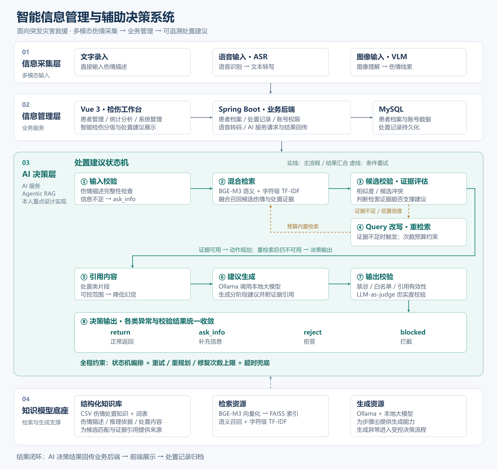
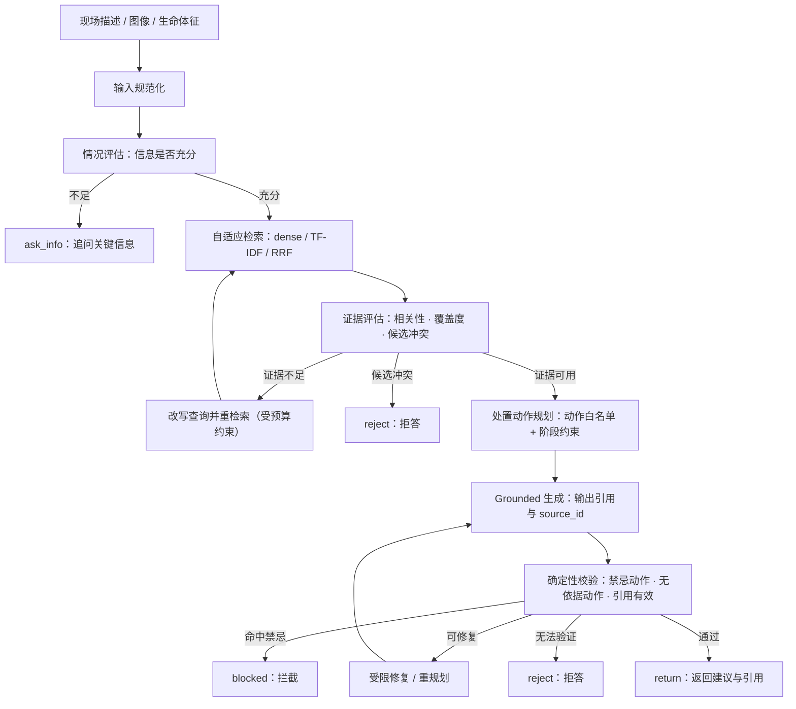
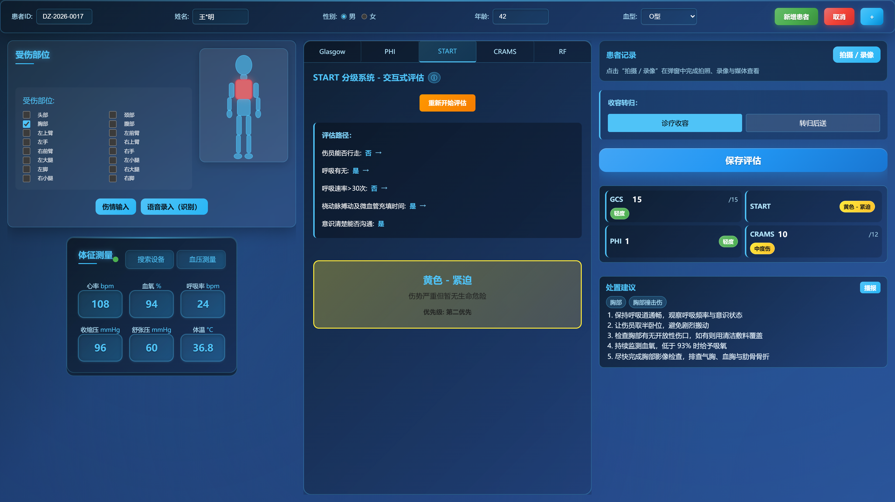
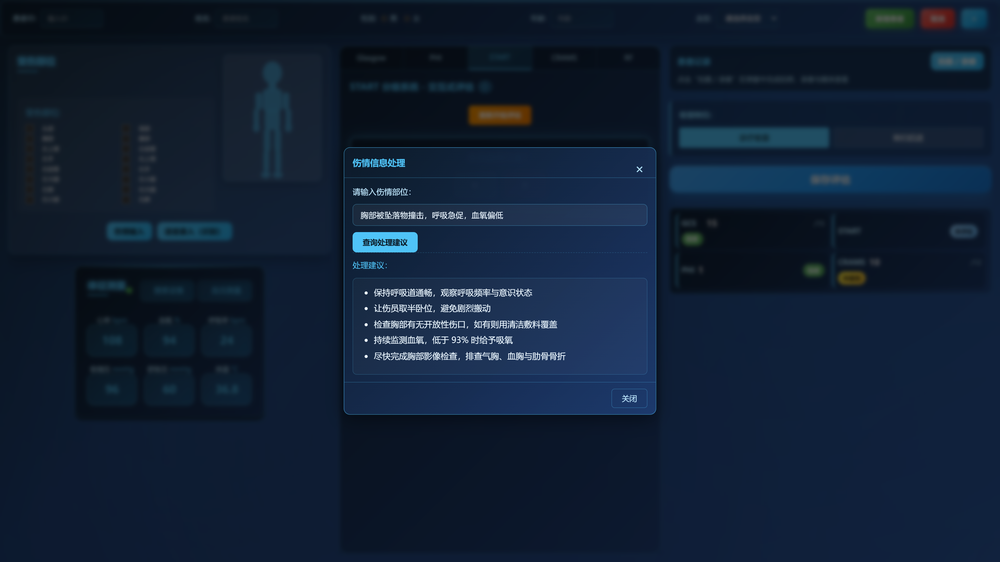

# 智能信息管理与辅助决策系统

面向突发灾害救援现场的伤情识别与处置辅助决策系统：现场人员通过文字、语音或图像描述伤情，系统结合本地知识库与检索增强生成（RAG）给出分阶段处置建议，并返回可追溯的引用来源。

> 本项目为技术演示与研究用途，不构成医疗建议，不能替代现场医疗人员的判断。

## 解决的问题

灾害现场信息碎片化、救援人员专业水平不一，处置建议容易出现两种风险：**答非所问**和**给出知识库之外的危险动作**。本项目把「检索 → 生成」扩展为一条带状态机约束的 Agentic 管线：

- 信息不足时主动追问，而不是硬猜
- 候选伤情冲突或证据不足时拒答，而不是强行给结论
- 生成结果经过确定性校验（禁忌动作、动作白名单、引用有效性）与忠实度校验
- 所有重试、重规划、修复都有次数上限和超时兜底

## 系统架构



### Agentic 决策流程



## 界面预览

| 现场检伤工作台 | AI 处置建议 |
|---|---|
|  |  |

界面截图为合成演示数据，不含真实患者信息。

## 技术栈

| 层 | 技术 |
|---|---|
| AI 服务 | Python 3.10+、Flask、BGE-M3、FAISS、scikit-learn、Ollama |
| 前端 | Vue 3、Vite |
| 后端 | Spring Boot 3、Java 17、MyBatis-Plus、MySQL 8 |
| 评测 | 自建开发集消融、合成故障注入、配对 bootstrap / McNemar 检验 |

## 目录结构

```text
.
├── ai-service/            # Agentic RAG 服务
│   ├── app.py             # Flask 入口（/agentic、/match/v2、/match、/health）
│   ├── agentic_*.py       # 编排、情况/证据评估、动作规划、修复、校验、状态机
│   ├── rag_retriever.py   # BGE-M3 dense / TF-IDF / RRF 检索
│   ├── rag_generator.py   # Grounded 生成与引用
│   ├── kb_build.py        # 知识库构建
│   ├── build_index.py     # FAISS 索引构建
│   ├── data/              # 伤情处置知识 CSV / 文本
│   ├── kb/                # 结构化知识记录与词表
│   ├── eval/              # 评测脚本、数据集、结果
│   └── tests/             # 单元与回归测试
├── web/                   # Vue 3 前端
├── server/                # Spring Boot 后端
│   └── src/main/resources/sql/schema.sql
├── scripts/               # 本地启动与模型下载脚本
└── docs/                  # 架构图与界面截图
```

## 快速开始

### 1. 初始化数据库

```bash
mysql -u root -p < server/src/main/resources/sql/schema.sql
```

演示账号：`admin / admin123`（仅本地演示，部署前请修改）。

### 2. 启动 AI 服务

```bash
cd ai-service
python -m venv .venv
.venv\Scripts\activate          # Windows
pip install -r requirements.txt
copy .env.example .env          # 填写 DASHSCOPE_API_KEY（可选，仅视觉分析需要）
python app.py                   # http://localhost:5800
```

默认使用 BGE-M3 混合检索。首次运行需要下载权重并构建索引：

```powershell
powershell -ExecutionPolicy Bypass -File scripts\download_models.ps1
```

没有模型权重时，可在 `ai-service/config.ini` 中把 `[retrieval_service] mode` 改为 `tfidf`，使用字符级 TF-IDF 回退。

生成模型通过本地 Ollama 调用，默认 `deepseek-r1:1.5b`，可在 `config.ini` 的 `[ollama_service]` 中修改。

视觉分析服务为可选组件：`python analyzer.py`（默认端口 6800，见 `config.ini` 的 `[analyzer_service]`）。未启动时仅图像分析接口不可用，文字与语音链路不受影响。

### 3. 启动后端

```bash
cd server
mvn spring-boot:run             # http://localhost:8014
```

数据库与外部服务通过环境变量配置，见根目录 `.env.example`。

### 4. 启动前端

```bash
cd web
npm install
npm run dev                     # http://localhost:5174
```

页面入口：

- `/#/field` 现场检伤工作台
- `/#/manage` 患者管理
- `/#/statistics` 统计分析
- `/#/admin` 系统管理
- `/#/login` 登录

## 评测

评测脚本与数据位于 `ai-service/eval/`，结果位于 `ai-service/eval/results/`。以下均为开发集消融，不是独立标注的临床测试集。

**检索（130 条可回答查询）**

| 方案 | Top-1 | MRR@3 | Top-3 召回 |
|---|---:|---:|---:|
| 纯字符 TF-IDF | 61.5% | 70.3% | 80.8% |
| BGE-M3 + 字符 TF-IDF | 76.2% | 82.4% | 90.0% |
| 混合检索 + BGE-reranker 精排 | **84.6%** | **90.1%** | **96.2%** |

精排相对混合检索：Top-1 +8.5pp（McNemar p=0.035），MRR@3 的 95% 配对 bootstrap CI 为 [0.027, 0.129]，Top-3 召回 +6.2pp。精排为离线消融，线上默认未启用；8GB 显存下 BGE-M3 与 reranker 需分阶段加载。单路 Dense 与混合检索的差异不显著，因此不宣称「混合检索优于 Dense」。

**决策与安全（合成注入）**

- 13 条合成用例：Agentic 管线将决策正确率由 61.5% 提升至 100%，危险/无依据结果放行率由 15.4% 降至 0。
- 19 个合成故障原型：注入的禁忌动作 2/2 被拦截，危险结果 0/12 放行。

开发集没有独立标注；检索相似度只表示语义接近程度，不是置信度或概率。合成注入结果只验证已覆盖的决策与安全机制，不表述为临床准确率。详细口径见 `ai-service/eval/evaluation_manifest.json`，复现脚本见 `ai-service/eval/`。

精排消融额外需要 reranker 权重（约 2.2GB）：

```bash
modelscope download --model BAAI/bge-reranker-v2-m3 \
  --local_dir ai-service/models/bge-reranker-v2-m3
```

## 设计边界

- 系统的定位是**信息整理与决策辅助**，最终处置由现场医疗人员决定。
- 检索相似度（dense cosine）只表示语义接近程度，不是置信度或概率；阈值用于控制「答 / 不答」，不用于表达医学确定性。
- 候选伤情冲突检测基于检索排序与处置路径差异，是**冲突筛查**，不是医学冲突判定。
- `reject`、`blocked` 是安全策略的输出，不代表系统完成了风险识别。
- 知识库来自公开急救资料的结构化整理，未经过临床验证。

## License

[MIT](LICENSE)
